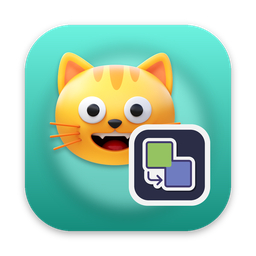
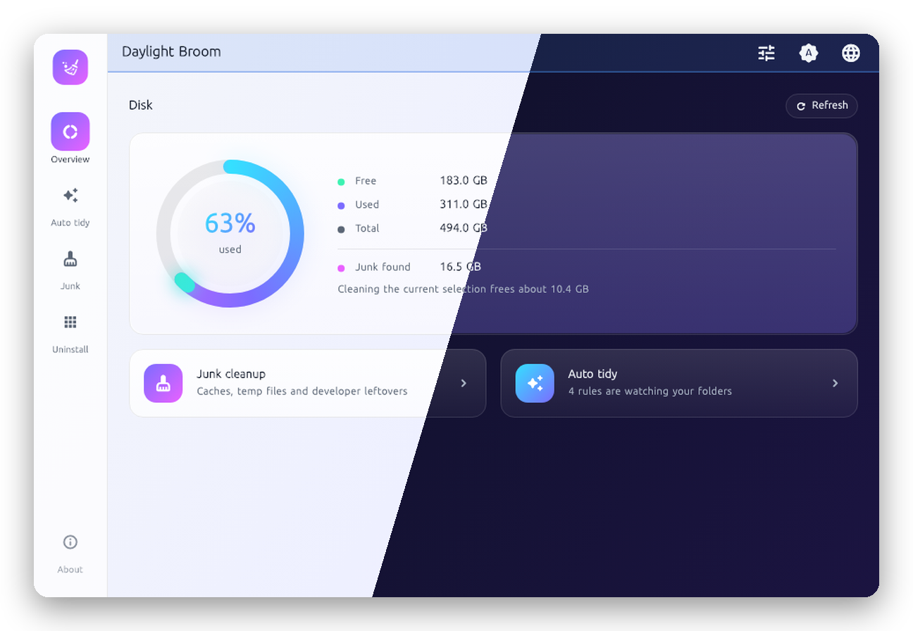
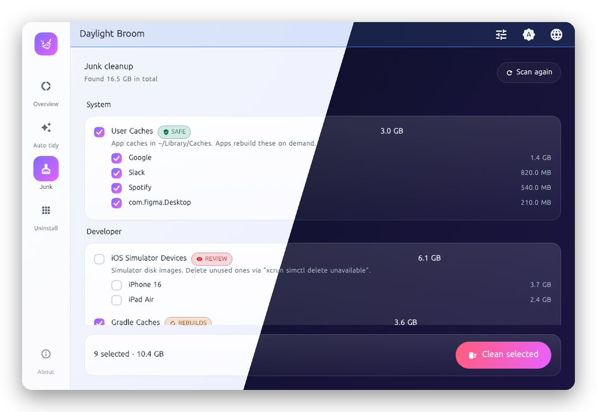
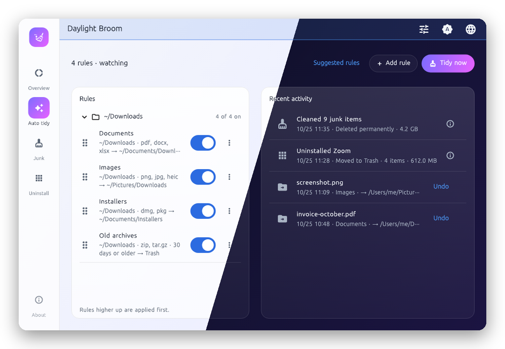

<!-- From jejezz/application-release-templates common/tool/readme @ conventions-v1.
     tool/readme/init_readme.py가 만든 파일입니다 — conventions/readme-guide.md 참고.
     {{TODO: …}}를 모두 채우십시오. 하나라도 남아 있으면 tool/readme/check_readme.py가 실패합니다. -->

<p align="center">
  
</p>

<h1 align="center">Daylight Broom</h1>

<p align="center">
  캐시와 개발 도구 찌꺼기를 치우고, 앱을 남은 파일까지 함께 제거하고, 다운로드 폴더를 규칙대로 정리하는 무료 오픈소스 <b>디스크 청소 + 파일 정리 유틸리티</b> (macOS, Windows). 트레이에 상주합니다.
</p>

<p align="center">
  <a href="https://github.com/jejezz/daylight-broom-flutter/releases/latest"></a>
  <a href="https://github.com/jejezz/daylight-broom-flutter/releases"></a>
  
  
  <a href="LICENSE"></a>
</p>

<p align="center">
  <a href="README.md">English</a> · <b>한국어</b>
</p>

<p align="center">
  
</p>

## 기능

- **안전 등급이 붙은 정크 정리** — 캐시, 로그, 임시 파일, 개발 도구 찌꺼기(Xcode DerivedData, Gradle, npm/Yarn/pnpm, pip, pub, Homebrew, NuGet, 브라우저 캐시…)를 찾아 *안전*, *다시 생성*, *확인 필요* 등급을 붙입니다. 스스로 다시 만들어지는 것만 미리 선택하고, 정리 전에 항상 한 번 더 묻습니다.
- **디스크 개요** — macOS에서는 Finder와 같은 값으로 사용량 링을 그립니다(비울 수 있는 공간은 여유로 셉니다). 지금 선택한 항목을 정리하면 얼마나 비는지도 링에 미리 보여 줍니다.
- **앱을 남은 파일까지 제거 (macOS)** — 번들 id로 `~/Library`에 남은 파일을 찾아 모두 휴지통으로 옮깁니다. 이름이 비슷해서만 찾은 항목은 다른 앱의 파일일 수 있어 선택하지 않은 채 보여 줍니다.
- **확장자·이름·크기·경과 일수 규칙** — 조건은 모두 만족해야 합니다(예: 30일 지난 `dmg, pkg`). 동작은 *폴더로 이동* 또는 *휴지통으로 이동*입니다. 목록 위쪽 규칙이 먼저 적용되고, 내려받는 중인 파일(`.crdownload`, `.download`, `.part`)은 건드리지 않습니다.
- **되돌릴 수 있는 것을 분명히** — *지금 정리*는 옮기기 전에 미리 보여 주고 모두 **되돌리기**가 됩니다. 앱 제거는 휴지통으로 갑니다. 정크 정리만 영구 삭제라서 항상 묻고, 그렇다고 알려 줍니다.
- **트레이/메뉴바 상주** — 창을 닫아도 계속 실행되고, 로그인 시 자동 실행을 켜면 창 없이 시작합니다. 라이트·다크, English · 한국어.

<p align="center">
  
  
</p>

## 설치

[**Releases**](https://github.com/jejezz/daylight-broom-flutter/releases/latest)에서 받습니다.

| OS | 파일 |
|---|---|
| macOS 12.0 이상 | `DaylightBroom-<버전>-macos-universal.dmg` — 열어서 앱을 Applications 폴더로 끌어다 놓으세요 |
| Windows 10/11 (x64) | `DaylightBroom-<버전>-windows-x64-setup.exe` |

**macOS:** Daylight Broom이 Downloads 폴더를 처음 볼 때 macOS가 허용 여부를 묻습니다. **허용**을 누르세요(허용하지 않으면 규칙이 동작하지 않습니다). 모든 캐시(Safari, 메일 등)까지 보려면 **전체 디스크 접근**을 켜세요. 개요 화면에서 단계별로 안내합니다.

**Windows:** 설치 프로그램에 아직 코드 서명이 없어서 SmartScreen이 "Windows의 PC 보호" 창을 띄웁니다. **추가 정보 → 실행**을 누르세요. Windows에서도 정크 정리와 규칙은 쓸 수 있고, 앱 제거는 아직 macOS에서만 됩니다.

**Stevedore나 MacBroom을 쓰던 분:** 이 앱이 둘을 하나로 합친 것입니다. 처음 실행할 때 Stevedore의 규칙, 기록, 설정, 로그인 시 자동 실행을 복사해 오고, 옛 데이터는 그대로 둡니다.

## 동작 방식

모든 일은 Dart가 합니다. 정크 크기는 macOS에서는 `du -sk`로(`~/Library/Caches`에 파일이 5만 개 넘는 일은 흔합니다), Windows에서는 별도 isolate에서 잽니다. 정리는 스캔한 폴더 밖의 경로를 거부하는 삭제기를 거치므로 홈 폴더나 드라이브 루트는 지우지 못하고, 휴지통은 지우지 않고 비웁니다. 규칙 엔진은 부작용 없는 `plan`과, 파일을 건드리기 직전에 다시 확인하는 `apply`로 나뉘어 있어서 미리보기, 실시간 감시(`Directory.watch()`: macOS는 FSEvents, Windows는 `ReadDirectoryChangesW`), 테스트가 같은 코드를 씁니다. 작은 Swift 브리지가 `FileManager.trashItem`을 불러서(Finder의 *되돌려 놓기*가 됩니다) 볼륨 용량을 Finder와 같게 읽고 전체 디스크 접근을 확인합니다. Windows에서는 휴지통과 디스크 크기를 PowerShell로 다룹니다.

## 개발

```bash
flutter pub get
flutter run -d macos
```

추가로 필요한 도구는 없습니다. macOS 앱은 Downloads를 읽고 임의의 폴더로 파일을 옮겨야 해서 일부러 **샌드박스를 끄고** 공증된 DMG로 배포합니다(App Store 배포 아님). 설정은 `~/Library/Application Support/DaylightBroom`(Windows는 `%APPDATA%\DaylightBroom`)의 `rules.json`, `history.json`에 저장됩니다.

정크 항목 추가: `lib/cleaner/scan_target.dart`에 `ScanTarget`(OS별 경로, 안전 등급)을 더하고, 제목과 설명을 `lib/cleaner/target_labels.dart`와 두 `.arb`에 더하면 됩니다. 그러면 스캔, 목록, 정리에 나타납니다.

README 스크린샷은 위젯 테스트가 가짜 데이터로 그리므로 개인 경로가 들어가지 않습니다: `flutter test tool/screenshots/capture_test.dart` 다음 `tool/readme/frame.py`.

릴리스: `scripts/bump-version.sh patch` → 병합 → `vX.Y.Z` 태그. CI가 모든 플랫폼을 빌드해서 올립니다. 규칙: [application-release-templates/conventions](https://github.com/jejezz/application-release-templates/tree/main/conventions).

## 크레딧

- 글꼴: [서울남산체](https://www.seoul.go.kr/seoul/font.do) (서울특별시)
- 아이콘: [Icons8](https://icons8.com)

## 라이선스

[MIT](LICENSE) © 2026 Jongyun Ahn
